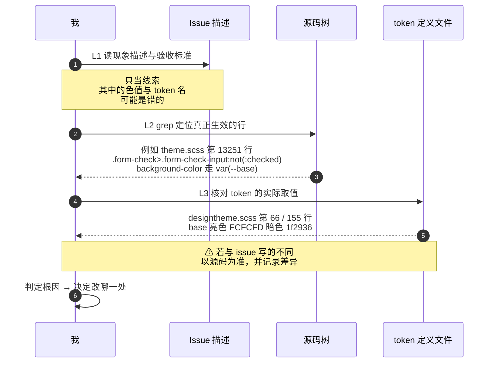
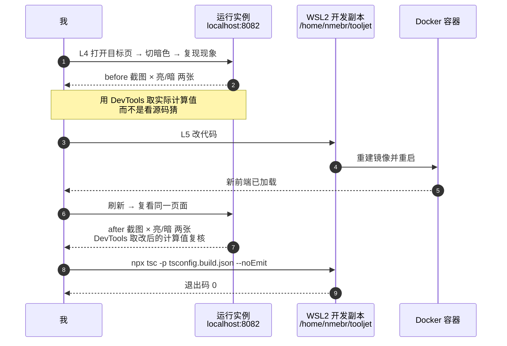
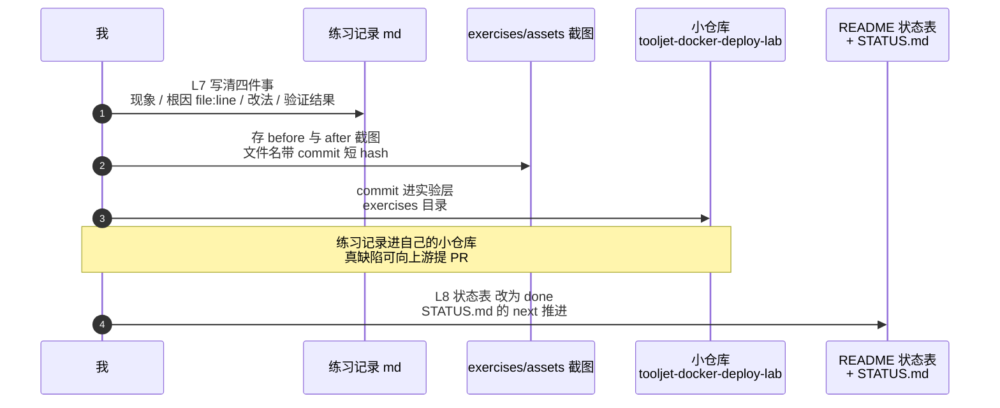

# 本地复现学习路径 · ToolJet UI 缺陷练习

> **定位**：ToolJet 学习线的**工作方法文档**。把上游 `good first issue` 里的每一条 UI 缺陷，当作一个**可动手的小练习**来用——读 issue 只当线索，动手改、跑起来看、截图、存档。
>
> **边界**（2026-11-22 更新；原「不 fork / 不提 PR」的限制已删除，理由见 §8）：
> - ✅ 可以向上游提 PR —— 已建 fork `fei33fei/ToolJet`，本地部署踩到的真缺陷按「一缺陷一 PR」提交（#19199–#19203）
> - ✅ 练习记录存进自己的小仓库 `fei33fei/tooljet-docker-deploy-lab` 的 `exercises/` 目录
> - ❌ 仍不参与 issue 认领与指派
> - ✅ 只做**本地部署 + 源码研读 + 本地修改验证**
>
> **证据分级**：✅ 本机实测可复现　🧭 读文件推出、逻辑确定但本机未跑通　🚧 尚未验证的推断，**不得当结论引用**
>
> **唯一真相源**：项目状态见 `D:\Fey\Desktop\code\STATUS.md`；练习清单与状态见 `exercises/README.md`

---

## 0. 速查表

| # | 环节 | 动作 | 本机状态 |
|:--|:--|:--|:--|
| L1 | 选题 | 从练习清单挑一条，看 issue 描述**当线索** | ✅ 清单已列 6 条，见 `exercises/README.md` |
| L2 | 定位 | grep 找到**真正生效**的那一行（不是最像的那一行） | ✅ 已定位 4 条练习的根因位置 |
| L3 | 核值 | 对照 token 在 `designtheme.scss` / `componentdesign.scss` 里的**实际定义** | ✅ 已核出 3 处 issue 与仓库不符 |
| L4 | 复现 | 在运行中的 8082 实例上复现，亮/暗双模式各截一张 **before** | ✅ 实例在跑；截图步骤 🚧 未实做 |
| L5 | 动手 | 在 WSL2 开发副本改代码 → 容器重建 → 刷新看效果 | ✅ 开发副本在 `/home/nmebr/tooljet` |
| L6 | 验证 | DevTools 取**实际计算值**复核 + `tsc --noEmit` + after 截图 | 🧭 命令已知，🚧 未实做 |
| L7 | 存档 | 写练习记录 md + 截图入 `assets/` + commit 进小仓库 | 🧭 规范见 §4 |
| L8 | 收口 | 更新 `exercises/README.md` 状态表 + `STATUS.md` 的 next | ✅ 机制已在用 |

---

## 1. 参与方

| 参与方 | 角色 | 说明 |
|:--|:--|:--|
| **我（学习者）** | 执行者 | 本项目中即本人 |
| **Issue 描述** | **线索，不是结论** | 只告诉你"哪里看起来不对"，不告诉你"哪一行真的在起作用" |
| **源码树** | 唯一事实源 | token 定义、selector 权重、实际生效位置全在这里 |
| **运行实例** | 裁判 | 8082 前端 / 3000 后端，最终以浏览器里看到的和 DevTools 取到的值为准 |
| **练习记录** | 沉淀物 | `exercises/<编号>-<slug>.md` + `exercises/assets/` 截图 |
| **小仓库存档** | 唯一归档 | `fei33fei/tooljet-docker-deploy-lab` |

---

## 2. 三张时序图

### 2.1 阶段一 · 选题与定位（L1–L3）



### 2.2 阶段二 · 复现、修改、验证（L4–L6）



### 2.3 阶段三 · 存档与收口（L7–L8）



---

## 3. 练习清单：6 条暗色模式缺陷

> 全部为上游 `good first issue` + `state:open`（2026-11-06 实测，共 9 条，这 6 条是前端 CSS 类、难度标 Beginner）。

| 编号 | issue | 现象 | 根因定位（已实测） | 难度 |
|:--|:--|:--|:--|:--|
| E1 | #18146 | 暗色模式下工作区设置页的 toggle 未选中态看不见 | `frontend/src/_styles/theme.scss:13251` → `background-color: var(--base)`；暗色 `--base` = `1f2936`（`designtheme.scss:155`），与页面背景同色 | 🟢 |
| E2 | #18145 | 登录页 4 个输入框边框色不对 | `#dadcde` 硬编码，散落 `theme.scss:2261/2270/2721/2954/5820/12880/12885` + `TooljetDatabase/Forms/` 4 个文件；正确 token `--border-default` = 亮 `CCD1D5` / 暗 `3C434B`（`componentdesign.scss:55` / `:234`） | 🟢 |
| E3 | #18151 | disabled 状态按钮的图标颜色不对 | 应走 `--icon-on-solid`（`componentdesign.scss:44`、`tailwind.config.js:53`），注意是**连字符**，不是 issue 写的 `icon/on-solid` | 🟢 |
| E4 | #18153 | OpenAI logo 在暗色模式看不见 | 数据源图标需暗色变体；仓库已有 `frontend/src/_styles/global-datasources.scss` 可参考同类图标处理方式 | 🟡 |
| E5 | #18152 | Anthropic logo 在暗色模式看不见 | 同 E4 | 🟡 |
| E6 | #18149 | Workspace settings > Groups 页 hover 时 tab 抖动 | hover 才加的 `border-bottom` 占了布局空间 → 改用绝对定位 `::after` 或常驻透明边框 | 🟡 |

**建议顺序**：E1 → E3 → E2 → E6 → E4 → E5。先做 E1，因为它把「暗色 token 实况」这件事彻底搞懂，后面几条都是同一套方法。

---

## 4. 存档规范

### 4.1 目录结构

```text
exercises/
├── README.md                    ← 学习清单 + 状态表 + 本文件的索引
├── 本地复现学习路径.md            ← 本文（工作方法 + 时序图）
├── 00-模板.md                    ← 单条练习记录模板
├── assets/                      ← 截图（文件名带练习编号与 commit 短 hash）
│   └── E1-toggle/
│       ├── before-light.png
│       ├── before-dark.png
│       ├── after-light.png
│       └── after-dark.png
└── E1-dark-mode-toggle.md        ← 单条练习记录
```

### 4.2 单条练习记录必填四件事

1. **现象**：怎么复现的，哪一页、哪个状态、亮/暗各什么表现
2. **根因**：真正生效的那一行，`file:line`；以及 issue 描述与仓库实况的差异（若有）
3. **改法**：改了什么，为什么这么改（附 diff 摘要）
4. **验证**：改后截图、DevTools 取到的计算值、`tsc --noEmit` 退出码

### 4.3 commit 约定

```
exercises(E1): 暗色模式 toggle 未选中态可见性

现象：暗色模式下工作区设置页 toggle 未选中态与背景同色
根因：frontend/src/_styles/theme.scss:13251 background-color 走 var(--base)
      designtheme.scss:155 暗色 base = 1f2936，与页面背景同色
改法：未选中态改走 design token，其余状态保持不变
验证：before/after 各亮暗两张截图入 assets/E1-toggle/
      DevTools 计算值复核，tsc -p tsconfig.build.json --noEmit 退出码 0
参考：上游 #18146（社区已有参考实现 #18293，仅覆盖 SSO 列表一处）
```

---

## 5. 参考实现对照：上游社区做到哪一步

> **定位**：这是**对照样本**，不是待办任务。看别人怎么改、改漏了什么，比自己闷头改更有价值。

社区对 #18146 已有一份 PR **#18293**（<https://github.com/ToolJet/ToolJet/pull/18293>），实测状态：

| 项 | 实测值 |
|:--|:--|
| 状态 | `open`，2026-10-07 创建，最后更新 2026-10-08，**停滞 30 天** |
| 评审 | `review_comments: 0`（维护者只回了"we will get it reviewed and merged soon"） |
| 检查 | 只有 2 个 Socket Security（依赖扫描），**无 build / lint / cypress**；`mergeable_state: unstable` |
| 改动 | `frontend/src/_styles/designtheme.scss` +6 行（新增 token `--controls-base-active`，亮 `8890992E` / 暗 `858C942E`）；`frontend/src/modules/WorkspaceSettings/components/BaseSSOConfigurationList/Configuration.scss` +15 −1 |
| 遗漏 | 只改了 **SSO 列表一处** toggle；未覆盖 `theme.scss:13251` 的通用未选中态与 `AppBuilder/LeftSidebar/GlobalSettings/styles.scss:54` |
| 细节 | PR body 写 `var(--controls/base-active)`（斜杠），代码里定义的是 `--controls-base-active`（连字符）——**body 与自己的代码对不上** |

**它为什么卡住（已实测的机制）**：`.github/workflows/ci.yml` 的 `pull_request.types` 是 `[labeled, unlabeled, closed]`，**不含 `opened`**，也不含 `synchronize`（后者只在 `code-coverage.yml` 里）。所以新开的 PR 在没人给它打标签前不会触发完整 CI——这份 PR 只有 Socket 两个检查，正是这个原因。

> 这条机制对我们**只有教学意义**（解释了上游社区协作为什么慢），不影响本地学习路径。

---

## 6. 不变量

1. **issue 描述只当线索** —— token 名、色值、selector 一律以仓库源码实测为准。已实测出 3 处出入（§3 表格 + §5）。
2. **每条练习必须有亮/暗双模式的 before/after 截图**，且截图能回溯到具体 commit（文件名带短 hash）。
3. **验证以运行实例为准** —— DevTools 取实际计算值 > 浏览器肉眼 > 静态读源码。selector 权重问题（如 `.form-switch > .form-check-input` 与 `.form-check > .form-check-input` 谁赢）必须实测。
4. **不改上游 clone 的历史** —— 练习代码以 `exercises/` 目录形式叠加到实验层；缺陷修复若要进 `patches/`，沿用既有的 `.patch` 形式入库约定。
5. **产出分两路** —— 练习记录（现象 / 根因 / 改法 / 验证）进自己的小仓库 `fei33fei/tooljet-docker-deploy-lab` 的 `exercises/`；**本地部署踩到的真缺陷按「一缺陷一 PR」提交上游**（fork `fei33fei/ToolJet`，已提 #19199–#19203）。仍不参与 issue 认领与指派。
6. **代理坑用单次绕过** —— `git -c http.proxy= -c https.proxy= ...`，不动全局 git 配置。
7. **数字带出处** —— 色值带 `file:line`，接口结论带 URL 与时间戳，截图带 commit hash。

---

## 7. 本机前置条件盘点（2026-11-06 实测）

| 项 | 状态 | 出处 |
|:--|:--|:--|
| ToolJet 实例 | ✅ 运行中，8082 / 3000 / 5432 / 6379 全部监听（PID 21444） | 本机 `Get-NetTCPConnection` |
| 登录方式 | `dev@tooljet.io / password`；管理员 `nmebryz@163.com` | `平台使用说明.md` |
| 开发副本 | ✅ WSL2 ext4 `/home/nmebr/tooljet`（改代码、跑容器在此）；Windows 侧 `D:\Fey\Desktop\code\ToolJet` 为镜像工作副本 | `STATUS.md` |
| 类型检查 | ✅ `npx tsc -p tsconfig.build.json --noEmit` 退出码 0 | `STATUS.md` 11-04 记录 |
| git 代理 | 🧭 全局 `http.proxy` → `127.0.0.1:3067`（Karing），未运行时 clone 必失败；单次绕过已实测 | `STATUS.md` 11-05 记录 |
| push 通道 | 🧭 需 `http.version=HTTP/1.1` + `http.lowSpeedLimit=0` + 重试 | `STATUS.md` 11-05 记录 |
| `gh` CLI | ✅ 已装（2.103.3），未登录；GitHub API 走 Git 凭据管理器里已存的 OAuth token | 11-22 实测：API 认证通过（用户 `fei33fei`） |
| fork 上游 | ✅ **已建** `fei33fei/ToolJet`（parent = ToolJet/ToolJet），PR 从这里提 | 11-22 实测；GitHub 拒绝非 fork 仓库做 PR head（422 `field: head, code: invalid`） |

---

## 8. 为什么删掉原来那条边界（2026-11-22）

**被删掉的是这句**：*「不 fork 上游仓库 / 不向上游提 PR —— 成果只存进自己的小仓库」*（写在本文顶部「明确不做的事」、时序图 note、不变量 #5、前置条件表四处）。

**它吞掉了什么**：这条约定是 2026-11-06 为了把「学上游 issue」和「给上游交代码」分开而定的。11-22 要把**本地部署过程中踩到的真缺陷**提交回上游时，它正好挡在前面 —— 照着它做，就只会把结论写进自己的仓库，而不会真的开 PR。

**为什么该删**：本地部署踩到的不是「学习素材」，是**上游代码里的真缺陷**：

| 缺陷 | 性质 | 现状 |
|:--|:--|:--|
| 种子工作区 `enable_sign_up` 与实例级 `ENABLE_SIGNUP` 错位 | 上游代码 bug | PR #19199 |
| 种子工作区缺 5 个内置静态数据源 | 上游代码 bug | PR #19200 |
| `ValidateQuerySourceGuard` 把内置 kind 当 UUID 查 | 上游代码 bug | PR #19201（带单测） |
| dev compose 的 plugins 依赖被 bind mount 遮蔽 | 上游编排疏漏 | PR #19202（容器内复现过） |
| dev compose 的 `PGRST_HOST` 缺端口 | 上游编排疏漏 | PR #19203 |

这类问题留在自己仓库里只有她一个人看得到；提回上游，受影响的人都能拿到修好的版本 —— 这正是「能改代码、能提 PR」这个原始目标的落点（见 `部署说明.md` 开头：「目标不是『跑起来就行』，而是**能改代码、能看热更新、能提 PR**」）。

**保留的部分**：❌ 仍不参与 issue 认领与指派；练习记录（现象 / 根因 / 改法 / 验证）仍进自己的小仓库 `exercises/` 目录。两条路各管各的，不混。

---

## 9. 变更记录

| 日期 | 变更 | 说明 |
|:--|:--|:--|
| 2026-11-06 | 初版（贡献流程版） | 原为「issue 检索 / 认领 / 提 PR」流程时序图，3 张 Mermaid 图经 Mermaid v11 `mermaid.parse()` 实测通过 |
| 2026-11-06 | **按她的边界重写为学习路径版** | 依 2026-11-06 她明确的口头边界（只本地部署学习 + 自己小仓库存档，不 fork / 不提 PR / 不认领），三张图换轴为「选题定位 → 复现修改验证 → 存档收口」；issue 清单降级为**练习清单**；新增社区参考实现对照（PR #18293 停滞 30 天、只覆盖一处 toggle、CI 触发机制）与存档规范；删除原「认领 / 提 PR / CI 触发」作为主线的内容，CI 机制降级为教学说明。文件名由《ToolJet贡献流程时序图.md》改为本文 |
| 2026-11-22 | **删除「不 fork / 不向上游提 PR」这条边界** | 她要求把本地部署踩到的问题分开提交 PR 到上游，而这条约定正好挡路 → 顶部「边界」块、时序图 note、不变量 #5、前置条件表四处一并改写，并新增 §8 说明删它的理由（真缺陷留在自己仓库里只有她一个人看得到）。仍保留「不参与 issue 认领与指派」。同日建 fork `fei33fei/ToolJet`、提 5 个 PR（#19199–#19203），并新增《本地化部署与测试说明.md》（部署流程 + 31 条测试用例） |
