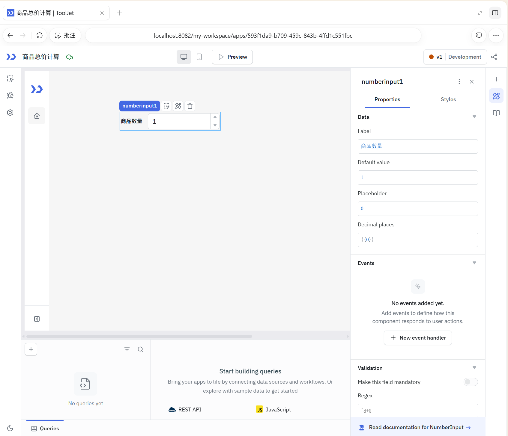
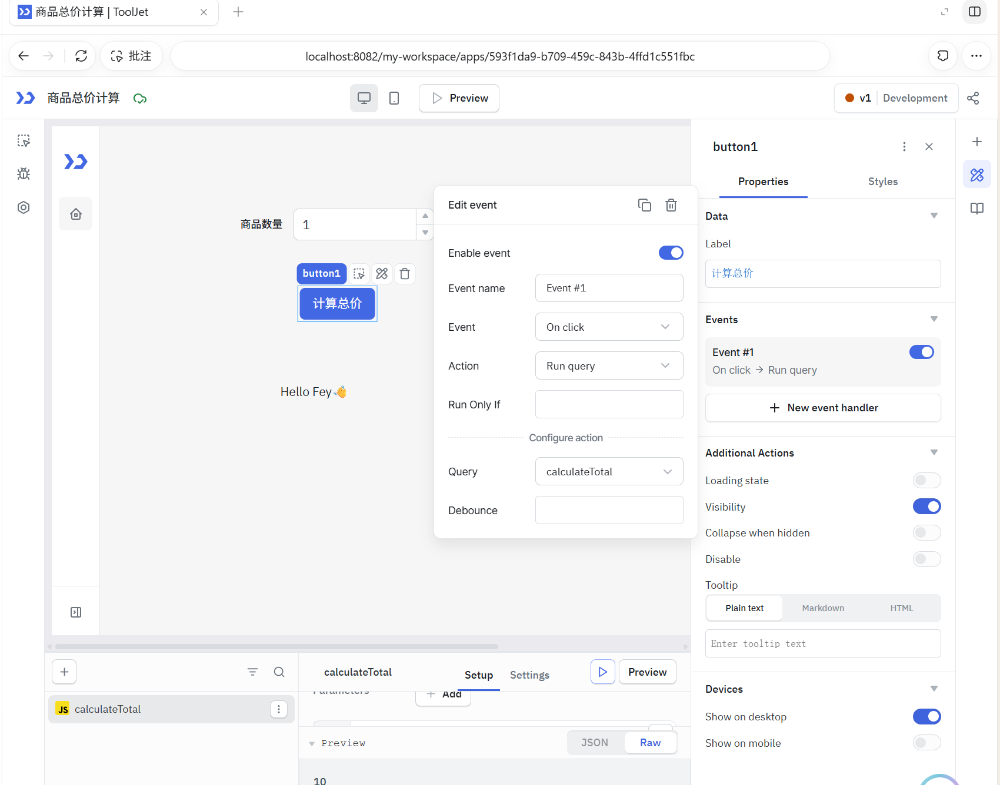
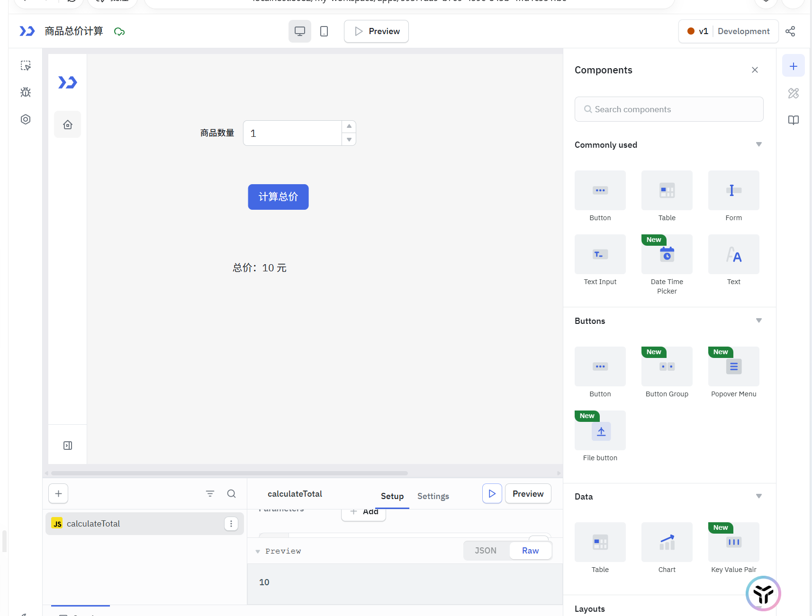
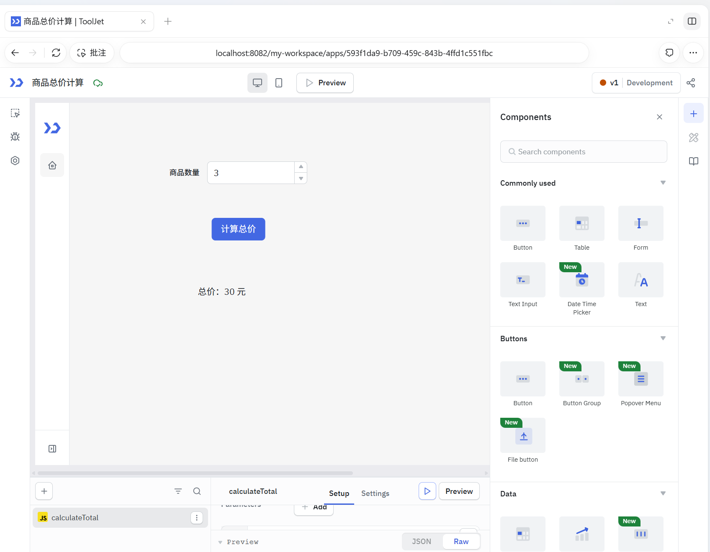

# ToolJet 本地平台使用说明

> 写给第一次用这个平台的人。
> 读完这一篇你会搞清三件事：**它能干什么**、**怎么登录**、**我的数据存在哪里**。
>
> 本文所有数字和状态都是在本机实测出来的，不是照抄官方文档。
> **第一次上手，直接看第五节「商品总价计算」图文教程**：不需要连接数据库，从创建应用到按钮计算、显示结果一步步完成。

---

## 一、这是什么

ToolJet 是一个**开源低代码内部工具平台**。简单说，它让你用「拖拽」而不是「写代码」的方式做出一套给内部同事用的网页工具——比如：

- 一个能查订单、导出 Excel 的后台页面
- 一个给运营填数据、主管看报表的看板
- 一个每天凌晨自动跑一遍、失败就通知的定时任务

三类核心能力：

| 能力 | 说明 |
|---|---|
| **搭界面** | 从组件面板拖组件到画布，填属性，不用写前端代码 |
| **接数据** | 连你自己的数据库 / API，在界面里写 SQL 或请求并渲染成表格、图表 |
| **跑流程** | 可在应用中用按钮事件触发查询；独立的节点工作流编辑器需要企业版，本机社区版不可用 |

它不是一个「网站生成器」，重点是**接内部系统**——所以你会看到大量数据库和 SaaS 连接器。

---

## 二、怎么登录

### 访问地址

| | 地址 |
|---|---|
| **界面（前端）** | <http://localhost:8082> |
| **接口（后端）** | <http://localhost:3000/api> |

地址在浏览器地址栏直接输就行。**必须是 `localhost`**，换成 `127.0.0.1` 或局域网 IP 目前不行。

### 账号密码

```
邮箱：nmebryz@163.com          ← 你的个人管理员账号
密码：shenyifei7563

邮箱：dev@tooljet.io           ← 初始化时种子脚本种出来的默认账号
密码：password
```

两个都是**管理员**（`admin: true`），都有建应用、连数据源、管成员的权限；独立工作流仍受版本功能限制（见 §4.4）。工作区 `My workspace` 里现在有这 2 个成员。

- `nmebryz@163.com` 是 2026-11-04 手工建的个人账号，密码是当时在注册页自己设的 `shenyifei7563`。
- `dev@tooljet.io` 是种子脚本 `npm run db:seed` 自动创建的，密码是上游写死的 `password`，删库重建后会连账号一起重新出现。

⚠️ **两个提醒**：

1. `dev@tooljet.io / password` 是**公开的默认密码**，只有你本机这套环境在用。如果这套环境要给同网络的人访问，**先改密码**（右上角头像 → Profile settings）；`nmebryz@163.com` 的密码是你自己设的，但强度也一般，建议一起改掉。
2. 别把这些密码填到任何公网表单里——`password` 那个就是个占位用的默认值。

### 登录发生了什么

- 登录成功服务端会下发一个 **httpOnly cookie**（名字 `tj_auth_token`），内容是一枚 JWT。
- **有效期约 2 年**（`Max-Age=63072000` 秒），所以平时不用重复登录。
- 这个 cookie 走的是 `SameSite=Strict` + `HttpOnly`，浏览器脚本读不到它，安全性上是对的。
- 密码本身**不存明文**——存的是 bcrypt 哈希（见 §六）。

### 也可以自己注册

登录页有 `Create an account`。本实例的注册是**开放**的，但要留意：

> **注册出来的是「终端用户」角色**，只能被授予查看/使用某个应用的权限，**不能自己建应用**。
> 想让人搭应用，要用管理员账号在成员管理里邀请并给对角色。

#### ⚠️ 踩坑：注册入口在，但点下去报 403（2026-11-04 遇到并已修）

如果你看到登录页有 `Create an account`，点「创建账户」却报
`Signup is disabled for the default workspace. Please contact the workspace admin.`，那不是你操作错了，
是**服务端两个开关对不上**：

| 开关 | 存在哪 | 决定什么 |
|---|---|---|
| 实例级 `ENABLE_SIGNUP` | `instance_settings` 表 | 登录页**要不要显示**「创建账户」入口 |
| 工作区级 `enable_sign_up` | `organizations` 表 | 服务端**要不要受理**注册请求 |

两者**不一致**时就会出这个「入口在、点不动」的尴尬状态：入口按实例级显示，注册请求按工作区级被拒。

社区版（CE）的校验在 `server/src/modules/onboarding/service.ts`：新用户没带工作区 ID 去注册时，
会落到默认工作区，此时若 `organizations.enable_sign_up` 为 false，直接 403。

**根因**：上游种子脚本 `server/scripts/seeds.ts` 建默认工作区时只给了 `isDefault: true`，
**没给 `enableSignUp`**，于是落到建表列的默认值 `false`（`server/migrations/1650455299630-OrganizationEnableSignup.ts`）；
而实例级的 `ENABLE_SIGNUP` 是从 `.env` 的 `DISABLE_SIGNUPS=false` 推出来的 `true`。两边天生就对不上。

**本机怎么修的**（两条都做了）：

1. 改数据库：`UPDATE organizations SET enable_sign_up = true WHERE is_default = true;`
2. 改种子脚本（WSL 侧 `server/scripts/seeds.ts`，+9 行未提交），让新建的默认工作区**按 `.env` 推导** `enableSignUp`：

   ```ts
   const enableSignUp = getEnvVars().DISABLE_SIGNUPS === 'false';
   ```

   > ⚠️ 这里必须用 `getEnvVars()` 而不是 `process.env`：`DISABLE_SIGNUPS` 是从 `.env` 文件读进
   > `getEnvVars()` 返回值的，**不会写进 `process.env`**（容器里 `docker exec server env` 查不到它）。
   > 用 `process.env` 写会恒为 `false`，补丁等于没打。
   > 顺带一提：服务端跑起来时 `ConfigModule` 会把 `.env` 载入 `process.env`，所以「服务端实例级默认值」
   > 和「种子脚本里的 `getEnvVars()`」在运行中的 server 进程里取值一致；但种子脚本是**独立进程**，走 `getEnvVars()`。

**以后自查**：

```bash
docker exec postgres psql -U tooljet -d tooljet_production -c \
  "SELECT o.slug, o.enable_sign_up, (SELECT value FROM instance_settings WHERE key='ENABLE_SIGNUP') AS instance FROM organizations o WHERE o.is_default=true;"
```

两个值都是 `t`/`true` 才是一致的。

### 忘记密码

登录页点 `Forgot?` 走找回流程。

> ⚠️ **本机环境没配 SMTP**（`SMTP_DISABLED=true`），所以**邮件发不出去**，找回链接不会到邮箱。
> 实际可行的办法是用管理员账号在成员管理里重置该用户的密码。

---

## 三、登录后你会看到什么

左侧竖排导航（图标 + 悬停显示名称），从上到下：

| 入口 | 页面 | 用来干什么 |
|---|---|---|
| 🏠 `home` | **Home** | 个人主页 / 快捷入口 |
| 📊 `apps` | **Dashboard** | 应用列表，建应用也从这儿开始 |
| ⚡ `workflows` | **Workflows** | 企业版的独立节点工作流；当前社区版不显示此入口 |
| 🗄️ `table` | **Database** | ToolJet 自带的 no-code 数据库（当前未启用，见 §六） |
| 🔌 `datasource` | **Data sources** | 管理所有数据源连接 |
| 📦 `integrations` | **Marketplace** | 社区市场插件（当前为空） |
| ⚙️ | **Settings / Workspace settings / Profile settings / Audit logs** | 实例、工作区、个人设置与操作审计 |

**本实例初始化时的状态（首次搭应用前实测）**：

| 项目 | 数量 |
|---|---|
| 应用 | **0**（全新空白） |
| 文件夹 | **0** |
| 数据源 | **0** |
| 市场插件 | **0** |
| 工作区成员 | **2**（`dev@tooljet.io`、`nmebryz@163.com`，都是管理员） |

首次打开 Dashboard 时一片空白是正常的。完成第五节教程后，本机已新增「商品总价计算」应用；同时已补齐 5 种内置数据源记录（REST API、JavaScript、Python、ToolJet DB、Workflows），它们是平台内部记录，不等于新建了 5 个外部数据库连接，也不会解锁企业版工作流功能。

---

## 四、这个平台能做什么

### 4.1 组件：83 个可视化组件

应用画布上能拖的组件，实测来自 `frontend/src/AppBuilder/WidgetManager/configs/widgetConfig.js` 的 `widgets` 注册表，共 **83 项**：

- **布局容器**：container、flexContainer、moduleContainer、moduleViewer、divider、verticalDivider、tabs、accordion、modal、modalV2、navigation、popoverMenu
- **表格与展示**：table、listview、pagination、kanban、chart、statistics、progressbar、circularProgressbar、tags、keyValuePair、jsonExplorer、timeline、steps、timer、qrscanner
- **表单输入**：form、textinput、text、textarea、richtextarea、numberinput、currencyinput、emailinput、phoneinput、passinput、datepicker、datePickerV2、daterangepicker、datetimePickerV2、timePicker、checkbox、radiobutton、radiobuttonV2、toggleswitch、toggleSwitchV2、dropdown、dropdownV2、multiselect、multiselectV2、rangeSlider、rangeSliderV2、treeSelect、cascader、starrating、tagsInput、colorPicker、calendar、fileinput、filepicker、fileButton
- **交互与其它**：button、buttonGroup、buttonGroupV2、link、icon、image、svgImage、html、iframe、codeEditor、jsonEditor、audioRecorder、camera、pdf、boundedBox、customComponent、libraryComponent

> 多数输入类组件都有 **V1 / V2 两个版本**，界面上是两个独立条目，功能类似、样式更新。

### 4.2 数据源：48 个连接器（实测 47 个可用）

来自 `plugins/packages/`，共 49 个插件包 = **48 个连接器** + 1 个公共基础库（`common`）：

| 类别 | 连接器 |
|---|---|
| **数据库（22）** | PostgreSQL、MySQL、MariaDB、MS SQL Server、MongoDB、Redis、CouchDB、ClickHouse、BigQuery、Snowflake、Databricks、DynamoDB、ElasticSearch、Firestore、Cosmos DB、RethinkDB、InfluxDB、SAP HANA、Oracle、IBM Db2、BaseRow、NoCodB |
| **文件 / 对象存储（4）** | AWS S3、Azure Blob Storage、Google Cloud Storage、MinIO |
| **API / 协议（5）** | REST API、GraphQL、gRPC、gRPC v2、OpenAPI |
| **SaaS / 通讯（17）** | Airtable、Amazon SES、Appwrite、Athena、Mailgun、Notion、SendGrid、Slack、SMTP、Stripe、Twilio、Typesense、WooCommerce、Zendesk、Google Sheets、Google Sheets v2、n8n |

> ⚠️ **IBM Db2 在本地不可用**（`ibm_db` 的原生驱动没装，见 §八）。**其余 47 个正常**。
> Oracle、SAP HANA 的原生驱动同样因为这个原因没装，但它们的 npm 包是纯 JS 薄模式，**加载正常、能否真正连上取决于你本机有没有对应数据库服务**。

### 4.3 查询

在应用编辑器的 **Query 面板**里，给数据源写 SQL 或 API 请求：

- 可以先 `Preview` 看结果对不对，再保存
- 查询结果能直接绑定到表格、图表等组件，组件属性面板里选「用哪个查询」即可
- 支持参数绑定，组件里的输入框可以作为查询参数
- 不连接外部数据库也能使用 **JavaScript** 查询进行计算；第五节给出了完整示例

### 4.4 工作流

**2026-11-04 实际操作核实：当前本机社区版没有可用的独立 Workflows 节点编辑器。** 原文根据功能开关判断「工作流可用」，这个结论不准确，现已更正。

- 虽然配置返回 `ENABLE_WORKFLOWS_FEATURE=true`，但**开关打开不代表当前版本包含完整实现**。
- 本地界面没有 Workflows 入口，直接访问工作流地址也没有进入可用编辑器。
- 源码中 `frontend/src/modules/workflows/index.js` 只在企业版加载该模块；社区版 `server/src/modules/workflows/controllers/workflows.controller.ts` 的创建方法仍是未实现的占位代码。
- 企业版的节点工作流可用于把查询、条件判断和动作串起来，并支持相应触发方式；本机入门练习采用**应用内的交互流程**：输入 → 按钮事件 → JavaScript 查询 → 展示结果。

> 想先学会实际搭建，直接按第五节操作即可，不需要先配置企业版、数据库或邮件服务。

### 4.5 多人协作与分享

| 能力 | 本实例状态 |
|---|---|
| 多人同时编辑同一个应用 | ✅ 已开启（`ENABLE_MULTIPLAYER_EDITING=true`） |
| 应用内评论 | ✅ 已开启（`ENABLE_COMMENTS=true`） |
| 应用发布 / 分享给别人访问 | ✅ 支持（每个应用有 development / staging / production 三套环境） |
| 应用嵌入到别的网站 | ✅ 支持（iframe / 公开链接） |

### 4.6 本实例的功能开关一览

这是服务端 `/api/config` 接口返回的真实配置：

| 开关 | 值 | 含义 |
|---|---|---|
| `RELEASE_VERSION` | `3.20.252-ce-lts` | 社区版长期支持分支 |
| `ENABLE_SIGNUP` | true | 开放自助注册 |
| `ENABLE_WORKFLOWS_FEATURE` | true | 开关已打开，但当前社区版未提供可用的独立工作流编辑器，见 §4.4 |
| `ENABLE_MULTIPLAYER_EDITING` | true | 多人协同编辑 |
| `ENABLE_COMMENTS` | true | 应用内评论 |
| `ALLOW_PERSONAL_WORKSPACE` | true | 允许个人工作区 |
| `ENABLE_WORKSPACE_LOGIN_CONFIGURATION` | true | 可自定义登录页 |
| `ENABLE_MARKETPLACE_DEV_MODE` | false | 社区市场开发模式（关） |
| `MCP_OAUTH_ENABLED` | false | MCP OAuth（企业版功能，社区版关） |

> **AI 功能在这个版本里是空的**——`server/src/modules/ai/controller.ts` 整个文件都是抛 `NotFoundException` 的桩，真正实现锁在私有 EE 子模块里。所以别指望能在这里用 AI 生成应用。

---

## 五、动手教程：商品总价计算（含实操截图）

### 5.1 做完以后是什么效果

我们做一个简单应用：**输入商品数量 → 点击「计算总价」→ 显示总价**。单价固定为 **10 元**。

这个练习不需要连接外部数据库，不需要配 API、邮件或定时任务。它让你先学会 ToolJet 最基础的四件事：拖组件、改属性、写查询、绑定按钮事件。

本机已完成的应用：[商品总价计算（编辑器）](http://localhost:8082/my-workspace/apps/593f1da9-b709-459c-843b-4ffd1c551fbc)。这个链接对应当前本机应用，复制到另一套环境时需要重新创建应用。

以下四张图来自 2026-11-04 本次实际操作，分别展示输入框设置、按钮事件、数量为 1 的结果、数量为 3 的结果。

### 5.2 第 1 步：新建一个空白应用

1. 打开 [本地应用列表](http://localhost:8082/my-workspace)。
2. 点击 **Create an app**；如果出现创建方式选项，选择空白应用。
3. 将应用命名为 **商品总价计算**，进入编辑器。

> **找不到 Create an app？** 先把浏览器窗口或右侧网页区域拉宽。本次实际遇到窗口过窄时，新建按钮被布局隐藏的情况；也可以在独立浏览器中打开本地平台。

进入编辑器后，先认清几个位置：

| 位置 | 用途 |
|---|---|
| 中间画布 | 放置和排列组件 |
| 最右侧竖栏顶部「＋」 | 打开 **Components** 组件面板，可搜索并拖入组件 |
| 选中组件后的右侧面板 | **Properties** 改内容和行为，**Styles** 改样式 |
| 底部 **Queries** 面板 | 创建和编辑查询，编写 JavaScript 计算逻辑 |
| 顶部 **Preview** | 打开整个应用的预览，模拟实际使用 |

### 5.3 第 2 步：添加并设置数量输入框

1. 点击最右侧竖栏顶部 **「＋」**。
2. 找到 **Number Input**，也可以在搜索框输入组件名称。
3. 将它拖到画布上。
4. 点击这个组件，在右侧 **Properties → Data** 中填写：

| 属性 | 填写内容 | 含义 |
|---|---|---|
| **Label** | `商品数量` | 输入框旁边显示的标签 |
| **Default value** | `1` | 打开应用时的默认数量 |
| **Decimal places** | `{{0}}` | 小数位数为 0，显示整数；把默认的 `{{2}}` 改为 `{{0}}` |

**组件名称保留为 `numberinput1`**，后面的代码会读取它。修改属性后，点击画布空白处，让编辑完成。



*图 1：数量输入框的属性设置。底部尚无查询时，可以看到 JavaScript 创建入口。*

### 5.4 第 3 步：添加按钮和结果文本

再次点击最右侧 **「＋」**，依次拖入下面两个组件，放在数量输入框下方：

| 组件 | 设置 |
|---|---|
| **Button** | 选中后，在右侧 **Properties → Data → Label** 中填 `计算总价`；组件名称可保留 `button1` |
| **Text** | 用于显示计算结果，先放到按钮下方，文本内容在第 6 步设置 |

注意选择 **Text**，不是 **Text Input**。Text 是展示文字，Text Input 是让用户输入文字。

此时画布从上到下应是：**商品数量输入框、计算总价按钮、结果文本**。Text 可能默认显示 `Hello Fey👋` 一类示例文字，后面会替换。

### 5.5 第 4 步：创建 JavaScript 计算查询

1. 在底部 **Queries** 面板点击 **JavaScript**。如果底部面板收起来了，先点击 **Queries**；已有查询时，可以先点查询列表上方的 **「＋」**，再选 JavaScript。
2. 新建查询通常叫 `runjs1`。将查询名称改为 **`calculateTotal`**，按回车或点击其他位置完成命名。
3. 清空代码编辑区中的示例代码，粘贴：

```javascript
return Number(components.numberinput1.value || 0) * 10;
```

这行代码的意思是：读取 `numberinput1` 的当前值，空值按 0 处理，转成数字后乘以单价 10，并返回结果。

4. 点击**查询编辑器里的 Run**。窗口较窄时，按钮可能只显示一个三角形运行图标。
5. 数量为 `1` 时，下方输出区应显示 **`10`**；输出区可以选择 **Raw** 查看数值。

> **代码区里不要额外套 `{{…}}`。** JavaScript 查询直接填写上面的代码；只有后面绑定文本内容时才使用双大括号。
>
> **查询名称大小写要一致。** 本文统一使用 `calculateTotal`，按钮和结果文本都要引用同一个名称。

如果看不到代码区或输出区，可以拖动画布与底部查询面板之间的分隔线，增大查询面板高度。

### 5.6 第 5 步：让按钮触发计算

1. 点击画布上的 **计算总价** 按钮。
2. 在右侧 **Properties** 中找到 **Events**。
3. 点击 **New event handler**，打开事件设置。
4. 按下表填写：

| 设置项 | 选择或填写 |
|---|---|
| **Enable event** | 保持开启 |
| **Event name** | 保留默认 `Event #1` 即可 |
| **Event** | `On click` |
| **Action** | `Run query` |
| **Query**（Configure action 下） | `calculateTotal` |
| **Run Only If** | 留空 |
| **Debounce** | 留空 |

点击弹窗外的空白处结束设置。右侧事件卡片应显示 **On click → Run query**，事件开关保持开启。



*图 2：按钮事件的完整配置。Query 字段选择的是计算查询 `calculateTotal`。*

### 5.7 第 6 步：把计算结果显示到 Text 组件

1. 点击画布上的 **Text** 组件，也就是原来显示示例文字的那一块。
2. 在右侧 **Properties → Data** 中找到文本内容输入区。
3. 清空原来的示例文字，粘贴：

```text
总价：{{queries.calculateTotal.data ?? 0}} 元
```

其中，`queries.calculateTotal.data` 读取计算查询的返回结果；`?? 0` 表示结果为 `null` 或 `undefined` 时使用 0。`{{…}}` 中写的是动态表达式，外面的「总价：」和「元」是普通文字。

数量为 `1` 并运行查询后，文本应显示 **总价：10 元**，效果如下：



*图 3：三个组件与计算查询已经连接起来，页面显示结果和查询返回值一致。*

### 5.8 第 7 步：预览并验证整个流程

1. 等顶部应用名称旁的云朵图标显示保存完成。
2. 点击**页面顶部的 Preview**，进入整个应用的预览。
3. 修改商品数量，再点击 **计算总价**。

| 输入数量 | 点击按钮后应显示 |
|---|---|
| `1` | 总价：10 元 |
| `3` | 总价：30 元 |
| `5` | 总价：50 元 |

**改完数量后，需要再次点击按钮，结果才会更新。** 我们把计算绑定在按钮的点击事件上，所以它不会随着每次输入自动执行。

本次实际操作已确认数量 `3` 能显示 **总价：30 元**。下图是用户提供的编辑器实操结果截图；判断是否在整个应用预览中，应以实际打开的页面为准。



*图 4：数量为 3 的实际结果，验证输入、按钮事件、查询和文本展示这一整条流程。*

> **两个 Preview 不要混淆**：页面顶部的 Preview 用于预览整个应用；底部查询编辑器中的 Preview 用于查看查询结果。检查按钮是否正常工作时，使用顶部的 Preview。

### 5.9 做完以后，你已经学会了什么

| 环节 | 本例的实现 |
|---|---|
| 输入 | Number Input 组件 `numberinput1` 接收数量 |
| 触发 | Button 的 `On click` 事件触发 `Run query` |
| 处理 | JavaScript 查询 `calculateTotal` 计算「数量 × 10」 |
| 展示 | Text 通过 `{{queries.calculateTotal.data ?? 0}}` 显示结果 |

这是当前社区版可以完成的**应用内交互流程**。独立的节点工作流编辑器仍受版本限制，见 §4.4。

### 5.10 本次踩坑：点击 JavaScript 报 UUID 错误（已修复）

本次曾出现以下提示，发生在点击 JavaScript 创建查询时，而不是运行计算代码时：

```text
Failed to create query: invalid input syntax for type uuid: "runjs"
```

**原因**：本地初始化脚本漏建了工作区内置数据源。前端找不到 JavaScript 对应的记录后，回退使用类型标识 `runjs`，后端却将它当成数据库 UUID 查找，因此报错。这不是输入框或计算代码写错了。

**2026-11-04 已在实际运行的 WSL 环境完成修复**：

- 给当前工作区补齐 5 种内置数据源及 15 条环境关联记录；重复执行补齐操作时没有重复新增记录。
- 调整 `server/src/modules/data-queries/guards/validate-query-source.guard.ts`，识别内置类型标识，并按当前登录用户所属工作区查找对应数据源。
- 调整 `server/scripts/seeds.ts`，新建工作区时创建内置数据源，已有初始化账号时也补齐缺失记录，保留已有配置。
- 新增 `server/test/modules/data-queries/unit/validate-query-source.guard.spec.ts`；9 项回归测试通过，并验证初始化脚本可以重复运行。
- 刷新编辑器后，已实际创建 `calculateTotal` 查询并运行，数量为 `1` 时返回 `10`；随后用户完成事件和文本绑定，确认数量为 `3` 时显示 `30`。

如果旧页面仍报错，先刷新编辑器再创建查询。如果在重新搭建的环境中复现，让维护者检查上述 WSL 修复是否保留，以及工作区内置数据源记录是否齐全。

### 5.11 进阶：连接示例数据库做订单看板

完成上面的入门练习后，可以继续做查询数据库的应用。下面保留原有的三步路线。

#### 第 1 步：加一个数据源

1. 左侧点 **Data sources** → `Add data source`
2. 选类型（PostgreSQL / MySQL / REST API …）
3. 填连接信息（主机、端口、库名、账号密码）
4. 点 **Test connection** → 绿了再 **Save**

> 💡 **想先试手？** 这套环境里已经预置了示例数据，可以直接连：
>
> | 项 | 值 |
> |---|---|
> | 类型 | PostgreSQL |
> | 主机 | `postgres` |
> | 端口 | `5432` |
> | 数据库 | `sample_db` |
> | 用户名 | `tooljet` |
> | 密码 | 见 `~/tooljet/.env` 的 `PG_PASS` |
>
> `sample_db` 里有 6 张表共 1779 行示例数据：`products`(10)、`sample_data_users`(500)、`sample_data_orders`(500)、`sample_data_country_gdp`(263)、`sample_data_organizations`(100)、`sample_data_product_cars`(406)。

#### 第 2 步：建应用、拖组件

1. 左侧 **Dashboard / Applications** → `Create an app`，起个名（比如「订单看板」）
2. 进入编辑器后，中间是画布；点击最右侧「＋」打开**组件面板**，选中组件后在右侧编辑属性
3. 把 `Table` 拖到画布上，再拖一个 `Button`、一个 `Text`

#### 第 3 步：写查询并绑定

1. 编辑器左下角打开 **Query 面板** → `Add query`
2. 选刚才建的数据源 → 写 SQL，比如：
   ```sql
   SELECT * FROM sample_data_orders LIMIT 100
   ```
3. 点 `Preview` 确认能返回数据 → `Save`
4. 选中画布上的 Table 组件 → 右边属性面板里把 **Query** 指向刚才那条查询
5. 顶部点 **Preview / Share** 看效果

> 到了这一步，你就已经做完一个真正能用的内部工具了。

---

## 六、你的数据存在哪里 ★

这一节回答「登录的密码和数据是存到哪里的」。

### 6.1 一句话回答

> **全部在这台机器的 WSL2 虚拟磁盘里**（`D:\` 盘里看不到，也不在 Windows 侧 Docker Desktop 里）。
> 物理位置是 Linux 的 `/var/lib/docker/volumes/`，**ext4 文件系统**，跟着 WSL 虚拟磁盘走。
> **密码以 bcrypt 哈希形式存进 PostgreSQL，密钥单独存在一个 `.env` 文件里。**

### 6.2 五个数据库，分别装什么

这套环境里 PostgreSQL 一共建了 **5 个库**（实测）：

| 数据库 | 体积 | 装的是什么 | 你会不会直接看到它 |
|---|---|---|---|
| **`tooljet_production`** | 13 MB | **ToolJet 自己的全部元数据**，共 100 张表 | 间接看到（你的应用、账号、数据源配置都在这） |
| **`sample_db`** | 9.2 MB | **示例数据**：6 张表 1779 行 | ✅ 会（连它就能拖表格） |
| `tooljet_db` | 空 | ToolJet **内置 no-code 数据库**的宿主库（当前未启用，`internal_tables` 0 行） | 目前用不到 |
| `tooljet` | 空 | 初始化脚本建的角色库 | 用不到 |
| `postgres` | 系统库 | PostgreSQL 自己的系统表 | 用不到 |

`tooljet_production` 那 100 张表里比较关键的几张：

| 表 | 装什么 |
|---|---|
| `users` | 账号（邮箱、密码哈希、状态、角色） |
| `apps` / `app_versions` / `pages` / `layouts` | 你的应用、版本、页面、布局 |
| `components` / `data_queries` | 每个组件的配置、每条查询的定义 |
| `data_sources` / `credentials` | 数据源连接配置（凭据加密后存这里） |
| `workflow_executions` / `workflow_schedules` | 工作流执行记录与定时计划 |
| `organization_users` / `group_users` | 成员与权限 |
| `audit_logs` | 操作审计日志 |

### 6.3 密码是怎么存的

**没有明文。** 确切地说：

- 密码哈希在 `users` 表的 **`password_digest`** 列，格式是 **bcrypt**：`$2b$10$…`（`$2b` = bcrypt 算法，`10` = cost 因子）。
- 这张表里**没有任何明文密码列**——查 `information_schema.columns` 只有 `password_digest`、`password_expiry`、`password_retry_count`、`forgot_password_token` 这些。
- 登录时服务端做的是「拿明文算一次 bcrypt，跟库里那个比」，**明文不落库、不进日志**。

所以：你在登录框里输的密码，只有在**你按回车的那一瞬间**存在于内存里，别的任何地方都没有。

### 6.4 密钥存在哪

四个敏感值放在同一个文件里：**`/home/nmebr/tooljet/.env`**（WSL 侧）。

| 变量 | 作用 | 改了会怎样 |
|---|---|---|
| `LOCKBOX_MASTER_KEY` | 加密「数据源凭据」的主密钥 | **已加密的凭据全部解不开** |
| `SECRET_KEY_BASE` | 签发登录 JWT 的密钥 | 所有已登录会话立刻失效 |
| `PGRST_JWT_SECRET` | 内置数据库 REST 层的密钥 | 内置库的 REST 接口失效 |
| `PG_PASS` | PostgreSQL 密码 | 数据库连不上 |

这个文件的保护措施：

- 上游仓库的 `.gitignore:31-32` 已经排除了 `/.env` 和 `/.env.test`
- 本地又额外加进了 `.git/info/exclude`（第 14–15 行）
- **两道保险**，任何情况下都不会被 `git add` 带走
- 文件权限 `644`，只有 WSL 里的 `nmebr` 用户和 root 能读

> ⚠️ **`.env` 和数据库是绑定的**：如果你把 `.env` 换掉但保留旧数据库，`LOCKBOX_MASTER_KEY` 变了 → 已存的数据源凭据解不开 → 那些数据源会连不上。
> **要迁移就两个一起搬。**

### 6.5 Redis 里放什么

`/var/lib/docker/volumes/tooljet_redis/_data`，容器内挂载在 `/data`，实测 **24 KB**。

里面**只有 2 个 key**，都是工作流队列的元数据：

```
bull:workflow-execution-queue:meta
bull:workflow-schedule-queue:meta
```

**你的业务数据一个都不在 Redis 里**。Redis 只当队列用（BullMQ），即使清空也不会丢你的应用和数据库——最多丢掉「正在排队中的任务」。

### 6.6 物理位置一览

| 东西 | 容器里挂在哪 | 宿主机（WSL）上的真实位置 | 体积 |
|---|---|---|---|
| PostgreSQL 数据 | `/var/lib/postgresql/data` | `/var/lib/docker/volumes/<一串哈希ID>/_data` | **94 MB** |
| PostgreSQL（上游挂的空卷） | `/data/postgres` | `/var/lib/docker/volumes/tooljet_postgres/_data` | **4 KB（空）** |
| Redis | `/data` | `/var/lib/docker/volumes/tooljet_redis/_data` | 24 KB |
| 密钥 | `/app/.env` | `/home/nmebr/tooljet/.env` | 2.2 KB |
| 源码 | `/app/server` `/app/frontend` `/app/plugins` | `/home/nmebr/tooljet/` | ~3.2 GB |

**这套环境的文件系统是 ext4**（`/dev/sdf`，1007 GB，已用 40 GB，还剩 917 GB）。
Windows 侧的 `D:\Fey\Desktop\code\ToolJet` **只是一份只读参考源码**，里面**没有**你的任何数据。

> ⚠️ **一个容易踩的坑**：
> 上游 compose 把 PostgreSQL 数据挂在 `/data/postgres`，但官方 `postgres:13` 镜像的 `PGDATA` 是 `/var/lib/postgresql/data`——
> **所以真实数据其实在那个「一串哈希 ID」的匿名卷里，名字好看的 `tooljet_postgres` 反而是空的。**
> 实际影响：`docker compose down` 不会删匿名卷（数据安全），但如果你想「彻底重置」，光删 `tooljet_postgres` 是没用的。

---

## 七、备份与恢复

数据全在 PostgreSQL 里，备份就是导出 SQL。

### 备份

```bash
# 在 WSL 里
mkdir -p ~/tooljet-backup
cd ~/tooljet
docker compose exec -T postgres pg_dump -U tooljet -d tooljet_production > ~/tooljet-backup/tooljet_production.sql
docker compose exec -T postgres pg_dump -U tooljet -d sample_db         > ~/tooljet-backup/sample_db.sql

# 别忘了密钥！没有它恢复出来的数据源凭据解不开
cp .env ~/tooljet-backup/env.backup
```

实测导出体积：`tooljet_production.sql` 约 **225 KB**，备份命令已跑通验证过。

### 恢复

```bash
cd ~/tooljet
docker compose exec -T postgres psql -U tooljet -d tooljet_production < ~/tooljet-backup/tooljet_production.sql
```

### 想彻底重来

```bash
cd ~/tooljet
docker compose down          # 停服务，保留数据卷
docker compose up -d         # 原样起来，数据还在
```

**注意**：真正清空数据要删**匿名卷**，光删 `tooljet_postgres` 命名卷没用（见 §6.6）。
删之前一定先按上面做备份。

---

## 八、常见问题

| 现象 | 原因 | 怎么办 |
|---|---|---|
| 浏览器打不开 8082 | 容器没起，或 WSL 没启动 | 先开 WSL 终端，再 `cd ~/tooljet && docker compose ps` 看容器在不在 |
| 页面一直转圈 Loading | 前端第一次要现编译 14MB 的 bundle，慢 | 等 20–60 秒；后续有缓存会快很多 |
| 看不到 Create an app 按钮 | 浏览器或右侧网页区域太窄，按钮被布局隐藏 | 拉宽网页区域，或在独立浏览器中打开本地平台 |
| 找不到 Workflows，直接打开工作流地址也是空白 | 当前社区版没有可用的独立节点工作流编辑器；功能开关为 true 不代表实现可用 | 按第五节先搭建应用内交互流程；正式节点工作流需要相应企业版功能 |
| 点击 JavaScript 提示 UUID 错误，内容包含 `runjs` | 初始化时缺少内置数据源，类型标识被当成数据库 ID | 本机已修复，见 §5.10；先刷新页面，若重建环境后复现，检查初始化脚本和内置数据源 |
| 点击「计算总价」后文本不更新 | 按钮事件、查询名称或文本绑定没有对应上 | 检查事件为 On click → Run query → calculateTotal，输入组件名为 numberinput1，文本按 §5.7 填写 |
| 修改数量后结果仍是旧值 | 本例只在点击按钮时执行计算 | 修改数量后再次点击「计算总价」；可用顶部 Preview 验证完整操作 |
| 登录提示密码错误 | 密码被改过 | 用管理员账号在成员管理里重置 |
| 「Forgot?」点了没反应 | **本机没配 SMTP，邮件发不出去** | 用管理员账号改密码 |
| 选 IBM Db2 数据源报错 | 原生驱动没装（本地构建时跳过了驱动下载） | 换其他数据源，或自己补装 IBM DB2 客户端 |
| 连 Oracle / SAP HANA 报奇怪的错 | 原生驱动同样没装 | 本地没这两个数据库服务时正常，用别的库 |
| 内置 no-code 数据库（Database 菜单）的数据连不上 | 上游 compose 的 `PGRST_HOST=postgrest` 没带端口，服务端拼出的 URL 走 80 而容器实际监听 3000 | 这是上游自身疏漏，**不影响主流程**（不影响你的应用、查询、数据源） |
| 想看操作日志 | Settings → Audit logs | 需要管理员权限 |
| 注册的同事说「建不了应用」 | 注册用户默认是终端用户角色 | 管理员在成员管理里把他提成 builder |

---

## 九、给维护者（可选看）

日常启停和排查：

```bash
wsl -d Debian
cd ~/tooljet

docker compose ps              # 看容器状态
docker compose logs -f server  # 看后端日志
docker compose logs -f client  # 看前端编译日志
docker compose restart server  # 只重启后端（改动代码后会自动热重载，一般不需要）
docker compose down            # 停服务（数据保留）
```

源码开发副本在 **`/home/nmebr/tooljet`**（WSL 的 ext4 磁盘上）。
VS Code 用 `\\wsl$\Debian\home\nmebr\tooljet` 打开。

改完代码后：

- 改前端 → 容器内 webpack 自动重编译，**浏览器刷新即可**
- 改后端 → Nest watch 自动重启
- 改 `plugins/` → plugins 容器 `tsc -b --watch` 自动重编译
- 改了依赖或 Dockerfile → 需要 `docker compose build <service>` 再重启

> 更详细的部署架构、踩坑记录、备份策略见同目录的 **`部署说明.md`**；
> 源码级解读见 **`ToolJet研读笔记.md`**。

---

## 附：一句话记住三个关键信息

1. **登录** → <http://localhost:8082>，`dev@tooljet.io` / `password`
2. **密码在哪** → 不在明文，在 PostgreSQL 的 `users.password_digest` 列里，bcrypt 哈希
3. **数据在哪** → WSL2 的 `/var/lib/docker/volumes/`，ext4 磁盘上，PostgreSQL 约 94 MB；业务数据在 `tooljet_production` 库，示例数据在 `sample_db` 库
